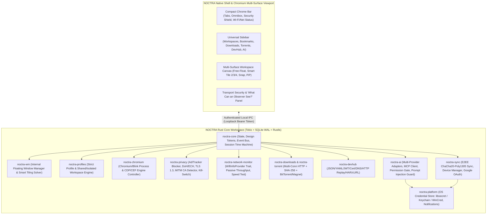

# NOCTRA — Architecture, Threat Model & Engineering Blueprint
**Product of NOCTA Ecosystem** | **Tagline:** *Beyond Browsing.*

---

## 1. Executive Architecture & Performance Strategy ("Potato-Laptop Fast")

To achieve ultra-low idle RAM, instant cold startup, and zero UI lag on low-end hardware ("laptop kentang") while guaranteeing **100% real Chromium/Blink + V8 rendering**, NOCTRA uses a **Zero-Bloat Native Rust Core + Shared-Runtime Chromium Architecture**:

1. **100% Rust Core Engine (`noctra-core` & 15 domain crates)**:
   - Compiled to native machine code with zero garbage collector pause and minimal binary overhead (~4–8 MB core footprint).
   - Manages all state, SQLite WAL persistence, profile/workspace isolation, internal floating window geometry & tiling solver, ad/tracker blocking filter engine, transport security verification, network quality & Wi-Fi telemetry, BitTorrent & multi-connection downloads, developer tools, and AI/MCP agent permission sandboxing.
2. **Modular Rendering Trait (`BrowserEngineBackend`) with Dual Chromium Integration**:
   - **Native Chromium App Runtime & CDP Multi-Target Process Controller**: Reuses system Chromium / Google Chrome (`--app` mode + isolated `--user-data-dir` per profile + Chrome DevTools Protocol WebSocket multiplexor & native viewport composition) OR embeds **CEF (Chromium Embedded Framework) / WRY Multi-Webview** without bundling a heavy Node.js main process.
   - **Aggressive Potato-Hardware Resource Optimizer (`ResourceGovernor`)**:
     - **Auto-Tab & Surface Hibernation**: Automatically freezes background tabs/floating surfaces after configurable inactivity thresholds (e.g., 30s/60s in Low-Spec Mode), releasing V8 heap and GPU textures while keeping instant state restoration in Rust SQLite.
     - **Zero-Allocation Ad & Tracker Filter**: Blocks heavy ad networks, tracking scripts, and autoplay telemetry *before* the renderer allocates DOM/V8 memory, cutting webpage RAM consumption by 40–65%.
     - **Zero-Animation / Hardware-Conscious UI**: Strict 1px borders, zero CSS `backdrop-filter: blur()` (which kills integrated Intel HD GPUs), and O(1) DOM layout updates.



---

## 2. Threat Model & Mitigation Matrix (Section 30 & 14B)

| Threat Category | Attack Vector | NOCTRA Mitigation Implemented in Rust |
|---|---|---|
| **Malicious Webpage / Renderer Escape** | Untrusted JS attempts to read API tokens, execute shell commands, or escape origin | Strict Chromium sandbox + site isolation; IPC requires per-session cryptographic capability token held only by privileged shell frame; webpage surfaces run in isolated security contexts. |
| **Prompt Injection via Webpage Content** | Malicious hidden text on a webpage instructs AI assistant to exfiltrate cookies/files or run tools | `noctra-ai` enforces structural boundary separation (`SystemInstruction`, `UserPrompt`, `UntrustedWebContent`, `ToolOutput`), strips control tokens, scans for injection patterns, and enforces **code-level `AgentPermissionGate`** (default-deny; high-risk tools require explicit user confirmation token). |
| **API Token & Credential Theft** | Tokens leaked in SQLite, logs, crash dumps, or HTTP redirects | `noctra-platform` stores secrets in OS keyring (`libsecret` / Keychain / WinCred) or AEAD ChaCha20-Poly1305 vault with explicit consent fallback; DB only stores opaque `cred_ref://` URIs; HTTP client disables cross-host credential forwarding on redirects; custom `RedactedSecret` type prevents `Debug`/`Display` logging leaks. |
| **Cross-Profile & Workspace Data Leakage** | Work profile cookies/IndexedDB leak into Personal or Guest profile | Every profile gets a dedicated filesystem partition (`profiles/<uuid>/chromium_data`) and isolated cookie/storage namespace; `Isolated` workspaces receive distinct sub-partitions (`workspaces/<ws_uuid>/partition`). |
| **Network Eavesdropping & MITM Proxy (Section 14B)** | ISP, public Wi-Fi attacker, or corporate proxy inspects SNI, DNS, or injects custom root CA | HTTPS-only mode with downgrade interstitial; TLS 1.3 / QUIC preference; DoH resolver (Cloudflare/Quad9/Custom); non-public Root CA MITM detector on TLS chains; VPN/Proxy kill-switch; `SSLKEYLOGFILE` stripped in release builds; automated packet analyzer test verifying zero plaintext URLs/tokens. |
| **Compromised External MCP / AI Agent** | Connected agent returns malicious payload or requests unauthorized local command execution | Default-deny tool capabilities per agent; high-risk actions (`RunLocalCommand`, `DeleteFile`, `ModifyConfig`, `SubmitForm`) block in `PendingApproval` queue until explicit user approval; strict timeout and payload size caps. |
| **Malicious Downloads & Torrents** | Corrupted binary, path traversal in `.torrent` file list, or IP leak | Path sanitization against `..` traversal; mandatory SHA-256 checksum computation & verification; BitTorrent interface binding & kill-switch check before peer announce. |

---

## 3. "What Can an Observer See?" — Residual Metadata Transparency (Section 14B)

NOCTRA does not make false "100% unsniffable" claims. The built-in Transport Security Inspector dynamically computes and displays exact residual visibility per active protection mode:

| Protection Mode | Plaintext URL Path / Query / Headers | DNS Query Hostname | TLS SNI (Server Name) | Destination IP Address | Packet Size & Timing |
|---|---|---|---|---|---|
| **Standard HTTPS (TLS 1.3)** | Hidden (Encrypted) | Visible to local resolver/ISP | Visible in ClientHello | Visible | Visible |
| **HTTPS + DoH + ECH Active** | Hidden (Encrypted) | Hidden (Encrypted via DoH) | Hidden (Outer SNI only via ECH) | Visible to ISP/Router | Visible |
| **NOCTRA WireGuard VPN Mode** | Hidden (Encrypted) | Hidden (Tunneled inside WG) | Hidden (Tunneled inside WG) | Hidden from ISP (Only VPN Entry IP visible; visible to VPN exit) | Coalesced in tunnel (Timing still observable) |
| **NOCTRA Tor Mode** | Hidden (Encrypted) | Hidden (Tor Circuit DNS) | Hidden (3-Hop Onion Circuit) | Hidden from ISP & Exit correlation (Entry Guard sees client IP; Exit sees destination IP) | Padded 514-byte cells (Timing correlation possible by global adversary) |

---

## 4. Cargo Workspace & Crate Structure

```text
Noctra/
├── Cargo.toml                      # Workspace root
├── crates/
│   ├── noctra-types/               # Centralized Design Tokens, Models, Config, Errors, RedactedSecret
│   ├── noctra-platform/            # Cross-platform OS abstraction, Credential Vault, Native Notifications
│   ├── noctra-database/            # SQLite WAL engine, migrations, encrypted sync/session persistence
│   ├── noctra-profiles/            # Multi-profile isolation & Noctra Spaces (Shared vs Isolated Workspaces)
│   ├── noctra-wm/                  # Internal Floating Window Manager, Snap, Smart Tiling (2/3/4/Grid/Hybrid)
│   ├── noctra-privacy/             # Ad/Tracker engine, DoH, TLS 1.3/ECH/Root-CA MITM inspector, Kill-Switch
│   ├── noctra-network-monitor/     # WifiInfoProvider (Linux nl80211/nmcli/proc, Win/macOS stubs), SpeedTest
│   ├── noctra-downloads/           # Multi-connection HTTP downloader, resume, SHA-256 verifier, scheduler
│   ├── noctra-torrent/             # Native Rust BitTorrent & Magnet engine, Bencode parser, DHT/Tracker/Speed caps
│   ├── noctra-devhub/              # JSON/YAML/JWT/Base64/Hash/Regex/DNS/TLS Cert/HTTP Tester/HAR/cURL
│   ├── noctra-ai/                  # Multi-provider AI adapters, MCP client, Permission Gate, Prompt Injection Guard
│   ├── noctra-sync/                # E2EE ChaCha20-Poly1305 Sync engine, Conflict resolution, Google OAuth flow
│   ├── noctra-chromium/            # Chromium/Blink process launcher, CDP WebSocket controller, Live web proxy/renderer
│   └── noctra-core/                # Unified Browser Orchestrator, Resource Governor, Session Time Machine, Automation
├── apps/
│   └── noctra-desktop/             # Native Desktop Binary + Authenticated IPC Server + Multi-Surface Chromium UI
└── .github/workflows/ci.yml        # Cross-platform CI pipeline (Linux, Windows, macOS)
```
